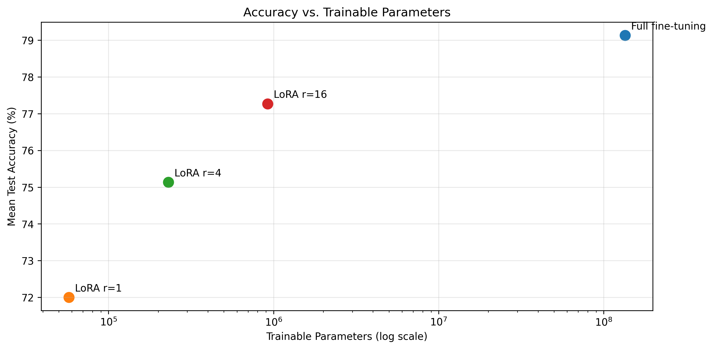

# AIGC-5500 Lab 6 - Fine-Tune with LoRA

**Student:** Daniel Alejandro Castillo Martin  
**Student ID:** N10019284  
**Course:** Advanced Deep Learning (AIGC-5500-0NA)  
**Professor:** Hossein Pourmodheji

---

Lab 06 submission for **Advanced Deep Learning (AIGC-5500)** in the Artificial Intelligence with Machine Learning postgraduate program at Humber Polytechnic.

This project investigates parameter-efficient fine-tuning using **HuggingFaceTB/SmolLM2-135M** for emotion classification. Full fine-tuning is compared against Low-Rank Adaptation (LoRA) at ranks 1, 4, and 16, evaluating classification accuracy, trainable parameters, training time, and memory consumption.

## 1. Setup

**Requirements:** Python 3.12, PyTorch, Transformers, PEFT, Datasets, Accelerate, Pandas, Matplotlib, and Jupyter.

Clone the repository:

```powershell
git clone https://github.com/dancmartin11/aigc-5500-lab-06-fine-tune-with-lora.git
cd aigc-5500-lab-06-fine-tune-with-lora
```

Create and activate a virtual environment (Windows PowerShell):

```powershell
python -m venv .venv
.\.venv\Scripts\Activate.ps1
pip install -r requirements.txt
```

For Linux/macOS, activate the environment using:

```bash
source .venv/bin/activate
```

A CUDA-compatible GPU is recommended for the full fine-tuning experiments.

## 2. Project Structure

```text
LAB-06/
├── docs/
│   └── AIGC5500_Lab06.pdf
├── scripts/
│   └── lab06_starter.py
├── src/
│   ├── __init__.py
│   ├── config.py
│   ├── utils.py
│   ├── losses.py
│   ├── lora.py
│   ├── verification.py
│   ├── experiments.py
│   └── memory.py
├── output/
│   └── figures/
│       └── accuracy_vs_parameters.png
├── daniel_alejandro_castillo_martin_LAB6.ipynb
├── .gitignore
├── README.md
└── requirements.txt
```

The `src/` package contains the reusable implementations and experiment utilities. The notebook provides the methodology, verification tests, experimental results, visualizations, and conclusions.

The original `lab06_starter.py` is preserved without modification.

## 3. Run

Open `daniel_alejandro_castillo_martin_LAB6.ipynb` in VS Code or Jupyter and execute the sections in order.

The notebook covers:

1. **Imports and Setup:** Reproducibility, hardware configuration, and starter validation.
2. **Zero-Shot Baseline and Answer-Only Loss:** Baseline evaluation and custom loss masking verification.
3. **LoRA Implementation and Verification:** Custom LoRA layer, initialization, merged weights, PEFT equivalence, and parameter counts.
4. **Controlled Fine-Tuning Experiments:** Full fine-tuning, LoRA rank sweep, and loss function comparison across three seeds.
5. **Memory Prediction and Measurement:** Predicted and measured memory consumption, including peak CUDA allocation.
6. **Conclusions:** Experimental findings, limitations, and accuracy-efficiency visualization.

Experiment configurations are defined in `src/config.py`. Training results are saved as JSON files under `output/results/`.

The experiment runner reuses existing JSON results when their recorded configurations match. To reproduce training from scratch, remove the previously generated experiment results before executing the full sweep.

## 4. Hardware and Reproducibility

| Component | Configuration |
|---|---|
| Python | 3.12.10 |
| PyTorch | 2.8.0+cu128 |
| CUDA | 12.8 |
| GPU | NVIDIA GeForce RTX 3060 Laptop GPU |
| Transformers | 5.22.2 |
| PEFT | 0.21.2 |
| Datasets | 5.1.0 |
| Accelerate | 1.15.0 |

**Experimental settings:**

| Parameter | Value |
|---|---|
| Pretrained model | HuggingFaceTB/SmolLM2-135M |
| Dataset | dair-ai/emotion |
| Training examples | 600 |
| Test examples | 500 |
| Data seed | 0 |
| Training seeds | 0, 1, 2 |
| Training steps | 120 |
| Batch size | 8 |
| Full fine-tuning learning rate | 5e-5 |
| LoRA learning rate | 1e-3 |
| LoRA ranks | 1, 4, 16 |
| LoRA scaling | alpha = 2r |
| Optimizer | AdamW |

All experiments use identical dataset samples, training steps, batch sizes, and seeds. Learning rates differ by fine-tuning method and were fixed before the main comparison.

## 5. Prediction (Written Before the Rank Sweep)

### Hypothesis 1: LoRA Rank 16 vs. Full Fine-Tuning

I expect LoRA rank 16 to approach the accuracy of full fine-tuning, potentially matching it within the variability observed across random seeds.

A higher adaptation rank provides greater flexibility to represent task-specific weight updates while retaining a relatively small trainable parameter count.

### Hypothesis 2: LoRA Rank 1 vs. Full Fine-Tuning

I expect LoRA rank 1 to perform worse than full fine-tuning and rank 16 because its lower-rank updates have more limited representational capacity.

However, the difference may not be substantial if the emotion classification task requires only a relatively simple adaptation of the pretrained model.

These predictions were documented before executing the rank sweep and are retained independently of the observed results.

## 6. Results

### 6.1 Zero-Shot Baseline

The pretrained model achieved **32.60% accuracy** without task-specific fine-tuning, compared with the uniform random-chance baseline of **16.67%**.

The zero-shot result provides the reference for evaluating the effectiveness of subsequent adaptation methods.

### 6.2 Custom LoRA Verification

The custom `LoRALinear` implementation was validated through numerical and parameter-count checks.

| Verification | Result |
|---|---|
| Initialization output difference | 0.00000000 |
| Expected trainable parameters (test layer) | 224 |
| Actual trainable parameters (test layer) | 224 |
| Merged weight output difference | 0.00000024 |
| PEFT output difference | 0.00000000 |

The implementation preserves the pretrained layer's output at initialization, freezes its original parameters, and produces equivalent outputs after merging the LoRA update.

Matching adaptation matrices also produced equivalent results against the PEFT reference implementation.

**Model-level parameter verification:**

| Rank | Target layers | Trainable parameters | Trainable (%) |
|---|---:|---:|---:|
| 1 | 60 | 57,600 | 0.0428% |
| 4 | 60 | 230,400 | 0.1710% |
| 16 | 60 | 921,600 | 0.6805% |

All theoretical counts matched the actual PEFT parameter counts.

### 6.3 Full Fine-Tuning vs. LoRA

Each configuration was evaluated with answer-only loss across three random seeds.

| Method | Seed 0 | Seed 1 | Seed 2 | Mean accuracy | Std. dev. |
|---|---:|---:|---:|---:|---:|
| Full fine-tuning | 79.0% | 78.8% | 79.6% | **79.13%** | 0.42 pp |
| LoRA r=1 | 72.2% | 71.6% | 72.2% | 72.00% | 0.35 pp |
| LoRA r=4 | 76.4% | 74.4% | 74.6% | 75.13% | 1.10 pp |
| LoRA r=16 | 77.0% | 76.4% | 78.4% | 77.27% | 1.03 pp |

Full fine-tuning achieved the highest mean accuracy, followed by LoRA rank 16.

LoRA rank 16 approached full fine-tuning within **1.87 percentage points**, while updating only 0.68% of the model's parameters.

Rank 1 performed 7.13 percentage points below full fine-tuning, supporting the original prediction that limited adaptation capacity could reduce classification performance.

All methods substantially outperformed the zero-shot baseline and uniform random chance.

### 6.4 Answer-Only vs. All-Token Loss

LoRA rank 16 was also trained with the starter's all-token loss for the same three seeds.

| Loss function | Seed 0 | Seed 1 | Seed 2 | Mean accuracy |
|---|---:|---:|---:|---:|
| Answer-only | 77.0% | 76.4% | 78.4% | **77.27%** |
| All-token | 71.6% | 70.2% | 71.0% | 70.93% |

Answer-only loss outperformed all-token loss by **6.33 percentage points** on average.

The results indicate that focusing supervision on classification labels was more effective than also predicting input prompt tokens under the fixed training budget.

### 6.5 Accuracy vs. Trainable Parameters



The visualization illustrates the trade-off between adaptation capacity and classification accuracy.

Increasing LoRA rank improved mean accuracy while maintaining substantially fewer trainable parameters than full fine-tuning.

## 7. Memory Analysis

### 7.1 Predicted vs. Measured Memory

Memory predictions use 32-bit weights, gradients, and Adam optimizer states.

| Method | Predicted total (bytes) | Measured total (bytes) |
|---|---:|---:|
| Full fine-tuning | 2,152,240,128 | 2,152,240,128 |
| LoRA r=1 | 538,981,632 | 538,981,632 |
| LoRA r=4 | 541,746,432 | 541,746,432 |
| LoRA r=16 | 552,805,632 | 552,805,632 |

Predicted and measured persistent training-state memory matched exactly across the experimental configurations.

LoRA reduced persistent memory requirements by approximately **74% to 75%** compared with full fine-tuning.

This reduction primarily resulted from eliminating gradient and optimizer storage for frozen pretrained parameters.

### Memory Component Breakdown

All values are in bytes. Predicted and measured values matched for every component across the three seeds.

| Method | Weights | Gradients | Adam states |
|---|---:|---:|---:|
| Full fine-tuning | 538,060,032 | 538,060,032 | 1,076,120,064 |
| LoRA r=1 | 538,290,432 | 230,400 | 460,800 |
| LoRA r=4 | 538,981,632 | 921,600 | 1,843,200 |
| LoRA r=16 | 541,746,432 | 3,686,400 | 7,372,800 |

The measured values matched the 32-bit memory predictions exactly. LoRA reduced gradient and optimizer memory by freezing pretrained parameters, while storing the additional adapter weights.

### 7.2 Peak CUDA Memory

| Method | Predicted persistent (GiB) | Mean peak CUDA (GiB) | Additional (GiB) |
|---|---:|---:|---:|
| Full fine-tuning | 2.004 | 2.716 | 0.711 |
| LoRA r=1 | 0.502 | 1.081 | 0.579 |
| LoRA r=4 | 0.505 | 1.253 | 0.749 |
| LoRA r=16 | 0.515 | 1.092 | 0.577 |

Peak CUDA allocation exceeded predicted persistent memory for every configuration.

The additional allocation reflects memory requirements beyond persistent training state, including activations and temporary computation tensors.

The rank-4 seed-0 experiment recorded a higher peak than the other rank-4 runs. This variation may reflect execution conditions or allocation history and does not establish that rank 4 intrinsically requires more peak GPU memory than rank 16.

## 8. Conclusion

The experiments demonstrate that LoRA provides substantial parameter and memory savings while maintaining competitive classification performance.

Full fine-tuning achieved the highest mean accuracy at **79.13%**, while LoRA rank 16 reached **77.27%** using fewer than 1% trainable parameters.

LoRA reduced persistent training-state memory by approximately 74% to 75%, although training time did not decrease proportionally to the reduction in trainable parameters.

The comparison of training objectives also showed that answer-only loss improved classification accuracy relative to all-token loss.

Overall, LoRA rank 16 provided the strongest accuracy-efficiency trade-off among the tested LoRA configurations, while full fine-tuning maintained a modest accuracy advantage.

## 9. Known Limitations

The findings are limited by:

- One pretrained language model and one emotion classification dataset.
- A relatively small training sample and fixed update budget.
- Three random seeds per configuration.
- Method-specific learning rates without an extensive hyperparameter search.
- Hardware-dependent training time and peak CUDA measurements.
- No statistical evidence establishing equivalence between LoRA and full fine-tuning.

The results demonstrate the behavior of the tested configurations but do not establish that the same accuracy or efficiency trade-offs will generalize to larger models or other downstream tasks.

## 10. Repository

**GitHub:** https://github.com/dancmartin11/aigc-5500-lab-06-fine-tune-with-lora

The repository contains the custom implementation, verification code, experimental notebook, saved visualization, and instructions for reproducing the results.